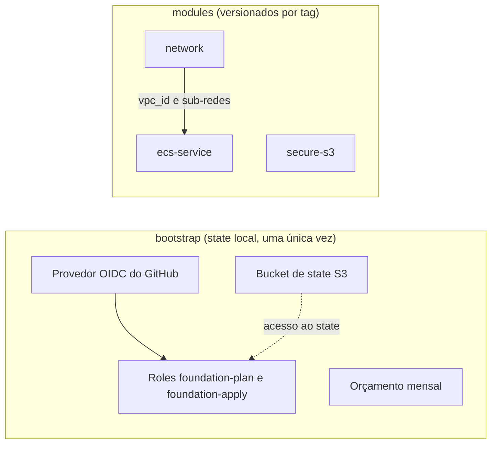
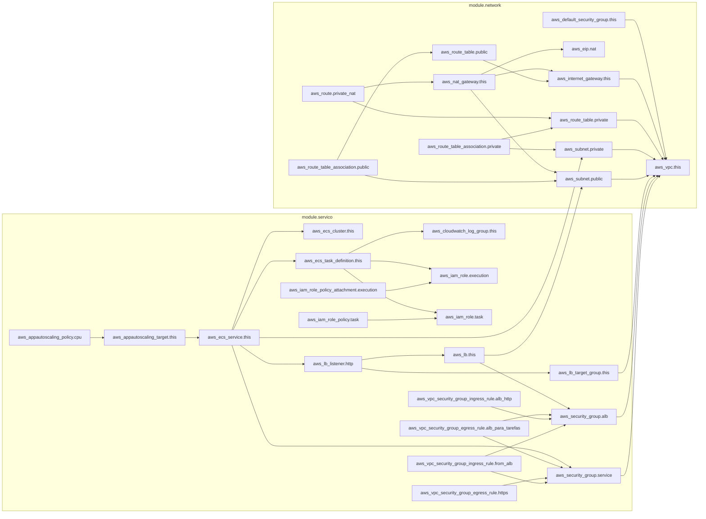

# terraform-aws-foundation

Módulos Terraform para AWS, com pipeline plan/apply, policy as code e detecção de drift.

> **Status:** projeto de estudo, em construção. **Nunca foi aplicado na AWS**: tudo é validado
> com `terraform validate`, `terraform test` (mock provider), `terraform plan` offline e
> políticas em Rego.

## Problema

_A preencher: por que uma fundação de IaC com módulos pequenos, testados e versionados._

## Arquitetura

Visão geral: o `bootstrap/` prepara state e identidade uma única vez; os módulos são
independentes, e o `ecs-service` recebe a rede do `network`.



Grafo de dependências do exemplo [`examples/ecs-service`](examples/ecs-service), gerado com
`terraform graph -format=mermaid`. Mostra todos os recursos, inclusive os opcionais (NAT, ALB e
autoscaling), que só existem quando ligados por variável.

<details>
<summary>Ver o grafo completo</summary>



</details>

Estrutura de pastas:

```
bootstrap/    bucket de state, provedor OIDC e roles (state local, uma única vez)
modules/      network, secure-s3 e ecs-service
examples/     um exemplo de uso por módulo
policy/       políticas em Rego (OPA/conftest)
.github/      workflows de plan, apply e drift
docs/         guias e runbook
```

## Como usar cada módulo

Cada módulo tem README próprio, com tabelas geradas pelo terraform-docs, e um exemplo em `examples/`.

| Módulo | Para que serve | Documentação | Exemplo |
|---|---|---|---|
| `secure-s3` | Bucket com criptografia, versionamento, bloqueio de acesso público e TLS obrigatório | [README](modules/secure-s3/README.md) | [examples/secure-s3](examples/secure-s3) |
| `network` | VPC com sub-redes públicas e privadas; NAT gateway desligado por padrão por causa do custo | [README](modules/network/README.md) | [examples/network](examples/network) |
| `ecs-service` | Serviço Fargate com logs, task role mínima, ALB opcional e autoscaling por CPU | [README](modules/ecs-service/README.md) | [examples/ecs-service](examples/ecs-service) |

```hcl
module "bucket" {
  source = "git::https://github.com/heldemfilipe/terraform-aws-foundation.git//modules/secure-s3?ref=v1.0.0"

  nome = "meu-bucket-unico"
}
```

A tag `v1.0.0` é criada no fim da Etapa 2.

## Decisões

| Peça | Escolha | Motivo |
|---|---|---|
| Terraform ou OpenTofu | _a decidir_ | _escrever o motivo_ |
| State | S3 com `use_lockfile = true` | Locking nativo, sem DynamoDB |
| Identidade do pipeline | GitHub Actions com OIDC | Sem chave de acesso de longa duração |
| Segurança | _Trivy ou Checkov_ | _escrever o motivo_ |
| Policy as code | OPA com conftest | Bloqueia o PR com mensagem legível |
| Role de plan | `ReadOnlyAccess` mais acesso ao state e só escrita do `.tflock` | Simplificação de estudo: lê mais do que precisa; um projeto real restringiria |
| Role de apply | Permissões estreitas, só buckets `foundation-lab-*` e o state; nunca `AdministratorAccess` | Limita o dano se o pipeline for comprometido |
| Aprovação do apply | Environment `production` com revisor obrigatório | O `sub` da role de apply exige esse environment; ninguém aplica de outra branch ou fork |
| Teste da trust policy | `terraform test` com `mock_provider` sobre o output `github_subs` | Sem AWS não dá para ver a AWS negar; o teste prova que só os `sub` certos são gerados e que valores com curinga são recusados |

## Custo

Custo real: zero, porque nada é aplicado. _A preencher: estimativa de custo dos módulos com
Infracost (Etapa 5, opcional)._ Como rodar sem AWS em [docs/00-instalacao.md](docs/00-instalacao.md).

## Experimentos

| Experimento | Status | Resultado observado |
|---|---|---|
| Drift | não executado | |
| Lock preso | não executado | |
| Refatoração sem recriar (`moved`) | não executado | |
| Recurso criado fora (`import`) | não executado | |
| Fork malicioso | não executado | |

## Etapas

- [x] Etapa 0: repositório e estrutura
- [x] Etapa 1: state remoto e identidade (só código: validado e testado, não aplicado)
- [ ] Etapa 2: módulos reutilizáveis
- [ ] Etapa 3: qualidade local
- [ ] Etapa 4: pipeline de plan e apply
- [ ] Etapa 5: policy as code e custo
- [ ] Etapa 6: drift e recuperação

## Licença

MIT. Veja [LICENSE](LICENSE).
