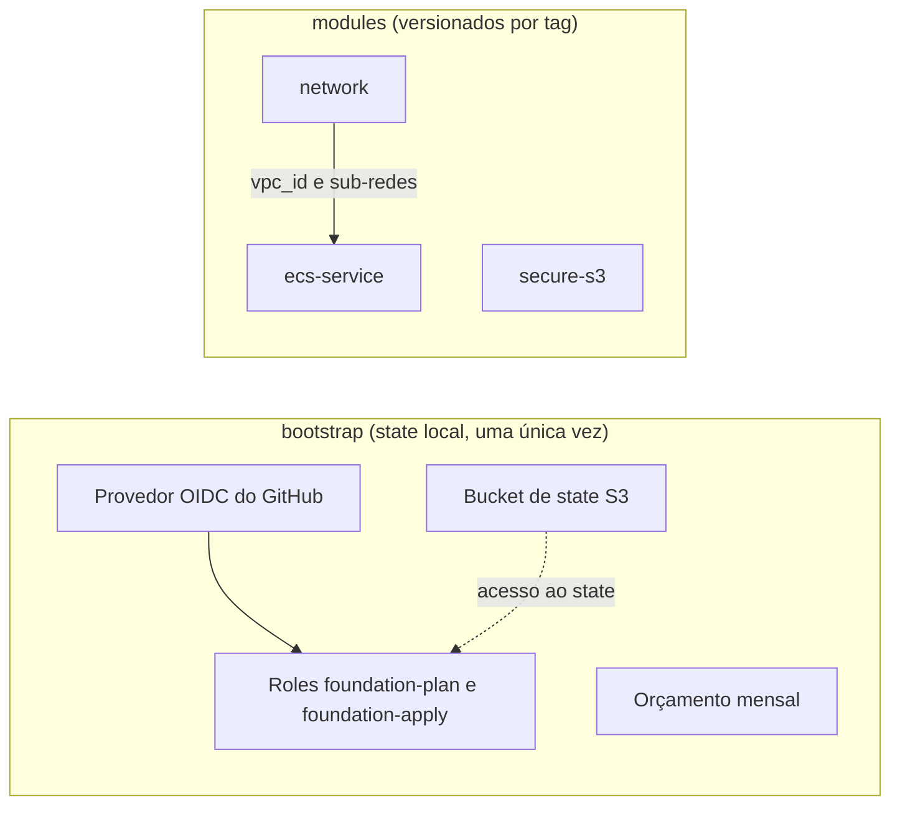
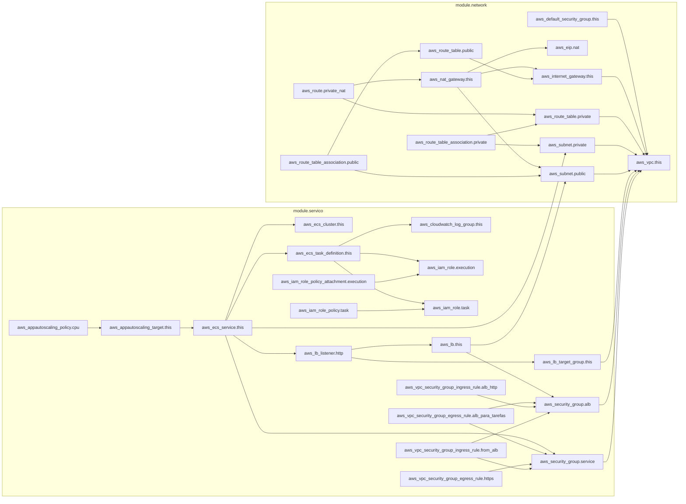

# terraform-aws-foundation

Módulos Terraform para AWS, com pipeline plan/apply, policy as code e detecção de drift.

> **Status:** projeto de estudo, em construção. **Nunca foi aplicado na AWS**: tudo é validado
> com `terraform validate`, `terraform test` (mock provider), `terraform plan` offline e
> políticas em Rego.

## Problema

Infraestrutura criada à mão, ou com Terraform copiado de projeto em projeto, acumula os mesmos defeitos:
buckets sem criptografia, redes diferentes a cada vez, `apply` sem revisão, chaves de acesso de longa duração
e mudanças feitas pelo console que ninguém percebe.

Este repositório mostra uma fundação que ataca cada um deles:

| Defeito | Resposta |
|---|---|
| Código copiado e divergente | Módulos pequenos, testados e versionados por tag |
| Chave de acesso de longa duração | GitHub Actions com OIDC e uma role por papel (plan, apply, drift) |
| `apply` sem revisão | Plan comentado no PR e apply só depois da aprovação no environment `production` |
| Configuração insegura chegando à `main` | Trivy, tflint e gitleaks no commit; políticas em Rego que bloqueiam o PR |
| Mudança por fora do Terraform | Job diário de drift que abre uma issue |

Operação do dia a dia: [runbook](docs/05-runbook.md) (state travado e drift) e
[experimentos](docs/06-experimentos.md) (o que foi reproduzido de verdade e o que não).

## Arquitetura

Visão geral: o `bootstrap/` prepara state e identidade uma única vez; os módulos são
independentes, e o `ecs-service` recebe a rede do `network`.



Grafo de dependências do exemplo [`examples/ecs-service`](examples/ecs-service), gerado com
`terraform graph -format=mermaid`. Mostra todos os recursos, inclusive os opcionais (NAT, ALB e
autoscaling), que só existem quando ligados por variável.

<details>
<summary>Ver o grafo completo</summary>



</details>

Estrutura de pastas:

```
bootstrap/    bucket de state, provedor OIDC e roles (state local, uma única vez)
modules/      network, secure-s3 e ecs-service
envs/dev/     raiz que o pipeline executa (usa os módulos, state remoto)
examples/     um exemplo de uso por módulo
policy/       políticas em Rego (OPA/conftest) e os testes delas
testdata/     planos de exemplo (um bom, um ruim) para as políticas
.github/      workflows de plan, apply e drift
docs/         guias e runbook
```

## Como usar cada módulo

Cada módulo tem README próprio, com tabelas geradas pelo terraform-docs, e um exemplo em `examples/`.

| Módulo | Para que serve | Documentação | Exemplo |
|---|---|---|---|
| `secure-s3` | Bucket com criptografia, versionamento, bloqueio de acesso público e TLS obrigatório | [README](modules/secure-s3/README.md) | [examples/secure-s3](examples/secure-s3) |
| `network` | VPC com sub-redes públicas e privadas; NAT gateway desligado por padrão por causa do custo | [README](modules/network/README.md) | [examples/network](examples/network) |
| `ecs-service` | Serviço Fargate com logs, task role mínima, ALB opcional e autoscaling por CPU | [README](modules/ecs-service/README.md) | [examples/ecs-service](examples/ecs-service) |

```hcl
module "bucket" {
  source = "git::https://github.com/heldemfilipe/terraform-aws-foundation.git//modules/secure-s3?ref=v1.0.0"

  nome = "meu-bucket-unico"
}
```

A tag `v1.0.0` foi criada no fim da Etapa 2 e não muda. O fechamento do projeto é a `v1.1.0`, que
inclui as exceções do Trivy nos módulos; o comportamento dos módulos é o mesmo.

## Decisões

| Peça | Escolha | Motivo |
|---|---|---|
| Terraform ou OpenTofu | _a decidir_ | _escrever o motivo_ |
| State | S3 com `use_lockfile = true` | Locking nativo, sem DynamoDB |
| Identidade do pipeline | GitHub Actions com OIDC | Sem chave de acesso de longa duração |
| Segurança | Trivy | Um binário só; lê o Terraform sem `init` nem `plan`; as exceções ficam no código com `#trivy:ignore` e justificativa |
| Policy as code | OPA com conftest | Bloqueia o PR com mensagem legível |
| Testes das políticas | `opa test` com planos mínimos, mais `conftest` sobre planos reais gerados pelo Terraform | O teste unitário trava o comportamento de cada regra; o plano real prova que o formato do `terraform show -json` é o esperado |
| Role de plan | `ReadOnlyAccess` mais acesso ao state e só escrita do `.tflock` | Simplificação de estudo: lê mais do que precisa; um projeto real restringiria |
| Role de apply | Permissões estreitas, só buckets `foundation-lab-*` e o state; nunca `AdministratorAccess` | Limita o dano se o pipeline for comprometido |
| Raiz do pipeline | `envs/dev`, só com `secure-s3` | A role de apply só tem permissão de S3 em `foundation-lab-*`; incluir `network` exigiria ampliá-la |
| Role de drift | `ReadOnlyAccess` mais acesso ao state, no `sub` `ref:refs/heads/main` | O job agendado não é PR nem usa environment, então precisa de uma role própria; só lê, e corrigir é sempre pelo pipeline de apply |
| Aprovação do apply | Environment `production` com revisor obrigatório | O `sub` da role de apply exige esse environment; ninguém aplica de outra branch ou fork |
| Teste da trust policy | `terraform test` com `mock_provider` sobre o output `github_subs` | Sem AWS não dá para ver a AWS negar; o teste prova que só os `sub` certos são gerados e que valores com curinga são recusados |

## Custo

Custo real: zero, porque nada é aplicado. A estimativa dos módulos que cobram (NAT e ALB) fica a cargo
do workflow [cost.yml](.github/workflows/cost.yml) com Infracost, **não executado** por exigir uma chave de
API própria. Como rodar sem AWS em [docs/00-instalacao.md](docs/00-instalacao.md).

## Experimentos

Sem conta AWS, o que dava para reproduzir localmente foi executado com provedores locais. Detalhes e saídas em
[docs/06-experimentos.md](docs/06-experimentos.md).

| Experimento | Status | Resultado observado |
|---|---|---|
| Drift | parcial | `plan -detailed-exitcode` saiu 0 (limpo), 2 (arquivo alterado por fora) e 1 (erro); o passo do `drift.yml` foi testado nos 5 caminhos com `gh` e `terraform` simulados. Alteração real pelo console da AWS: não executada |
| Lock preso | não executado | A tentativa local não reproduz (o Windows libera o lock quando o processo morre); só vale no S3. Procedimento no [runbook](docs/05-runbook.md) |
| Refatoração sem recriar (`moved`) | executado (local) | Só renomear: `1 to add, 1 to destroy`. Com `moved`: `0 to add, 0 to change, 0 to destroy` |
| Recurso criado fora (`import`) | executado (local) | Configuração igual ao real: `1 to import, 0 to add, 0 to destroy`. Configuração diferente: o Terraform importou e planejou **recriar** |
| Fork malicioso | parcial | O teste da trust policy confirma que só os `sub` previstos são aceitos. PR de fork real: não executado |

## Etapas

- [x] Etapa 0: repositório e estrutura
- [x] Etapa 1: state remoto e identidade (só código: validado e testado, não aplicado)
- [x] Etapa 2: módulos reutilizáveis (tag `v1.0.0`, testados com `mock_provider`)
- [x] Etapa 3: qualidade local (pre-commit, tflint, gitleaks e Trivy, em [docs/02-qualidade-local.md](docs/02-qualidade-local.md))
- [x] Etapa 4: pipeline de plan e apply (só código: validado com `actionlint`, não executado; veja [docs/03-pipeline.md](docs/03-pipeline.md))
- [x] Etapa 5: policy as code e custo (políticas testadas localmente com `opa` e `conftest`; workflows não executados; veja [docs/04-policy-as-code.md](docs/04-policy-as-code.md))
- [x] Etapa 6: drift e recuperação (`drift.yml`, [runbook](docs/05-runbook.md) e [experimentos](docs/06-experimentos.md); workflow não executado)

## Licença

MIT. Veja [LICENSE](LICENSE).
