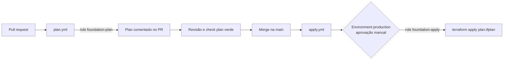

# Pipeline de plan e apply (Etapa 4)

> **Status:** escrito e validado com `actionlint`, **nunca executado**. Rodar de verdade exige uma
> conta AWS com o [bootstrap](../bootstrap) aplicado e o repositório configurado no GitHub.

## Visão geral

| Workflow | Dispara em | Role (sub do OIDC) | O que faz |
|---|---|---|---|
| [plan.yml](../.github/workflows/plan.yml) | `pull_request` | `foundation-plan` (`...:pull_request`) | `init -lockfile=readonly`, `fmt -check`, `validate`, `plan`, comenta no PR |
| [apply.yml](../.github/workflows/apply.yml) | push na `main` (só `envs/` e `modules/`) | `foundation-apply` (`...:environment:production`) | `plan -out`, guarda o texto do plan, `apply plan.tfplan` |
| [drift.yml](../.github/workflows/drift.yml) | todo dia às 06:00 (Brasília) e manual | `foundation-drift` (`...:ref:refs/heads/main`) | `plan -detailed-exitcode`; abre ou atualiza uma issue se houver drift. Detalhes no [runbook](05-runbook.md) |

O pipeline roda em [envs/dev](../envs/dev). O [bootstrap](../bootstrap) **não** passa pelo pipeline: ele cria
as roles que o pipeline usa, então é aplicado uma vez, à mão, com state local.

## Decisões

| Peça | Escolha | Motivo |
|---|---|---|
| Versão das actions | Fixadas por SHA do commit, com a versão em comentário | Uma tag pode ser movida; um SHA não. O Dependabot propõe as atualizações |
| Terraform no CI | `1.17.1` fixo, sem wrapper | Reprodutível; sem o wrapper o `terraform show > arquivo` não recebe saída extra |
| `-lockfile=readonly` | Ligado | O CI usa exatamente os providers do lock; não resolve versão nova sozinho |
| `concurrency` no apply | Grupo único, sem cancelar | Dois applies no mesmo state corromperiam o state; o segundo espera |
| `concurrency` no plan | Por PR, cancelando o anterior | Só o plan do último push interessa |
| Comentário do plan | Um por PR, atualizado a cada push | Não polui o PR; truncado em 60 mil caracteres (limite do GitHub: 65536) |
| Permissões do workflow | `id-token: write`, `contents: read`, e `pull-requests: write` só no plan | O apply não precisa comentar |
| Chave de state | `foundation/terraform.tfstate` | É a única que a role de plan lê e a de apply escreve. O state do bootstrap fica em outra chave, fora do alcance do pipeline |
| Plan no mesmo job do apply | Sim | Ver abaixo |

### Por que o apply refaz o plan

O roteiro sugere guardar o `plan.tfplan` do PR e aplicá-lo. Aqui o apply gera o plan e o aplica **no mesmo
job**, por dois motivos:

1. No push, o `sub` do OIDC é `ref:refs/heads/main`, que a role de plan não aceita. Só a role de apply,
   com o environment `production`, consegue assumir.
2. O código que entra na `main` depois do merge pode diferir do que foi planejado no PR.

O `apply plan.tfplan` ainda garante que é aplicado **exatamente** o plan gerado ali, e o Terraform recusa
o arquivo se o state mudou desde então. Quem aprova baseia a decisão no plan comentado no PR.

**Limite:** o plan do PR e o plan do apply podem divergir. Para o revisor ver o plan final *antes* de
aprovar, seria preciso um job de plan separado, com uma role ou environment próprios.

## Configuração no GitHub (feita à mão, por você)

Nada disso está no código; são configurações do repositório.

### 1. Aplicar o bootstrap uma vez

Com conta AWS real, a partir de `bootstrap/`: `terraform apply`. As saídas `state_bucket_name` e
`role_arns` alimentam o passo 2.

### 2. Variáveis do repositório

Em *Settings → Secrets and variables → Actions → Variables* (variáveis, não secrets: nenhum desses valores é
segredo, e o OIDC dispensa chave de acesso):

| Variável | Valor |
|---|---|
| `PLAN_ROLE_ARN` | `role_arns["plan"]` do bootstrap |
| `APPLY_ROLE_ARN` | `role_arns["apply"]` do bootstrap |
| `DRIFT_ROLE_ARN` | `role_arns["drift"]` do bootstrap |
| `STATE_BUCKET` | `state_bucket_name` do bootstrap |
| `AWS_ACCOUNT_ID` | ID da conta, 12 dígitos |

### 3. Environment `production`

*Settings → Environments → New environment*, com o nome exato `production` (o `sub` da role de apply
depende dele):

- **Required reviewers:** você.
- **Deployment branches:** apenas `main`.
- Marque **Prevent self-review** se houver mais de uma pessoa.

### 4. Proteção da `main`

*Settings → Rules → Rulesets → New branch ruleset*, alvo `main`:

- Exigir pull request com pelo menos 1 aprovação.
- Exigir o status check **`plan`** (o nome do job).
- Bloquear push direto e force push.

O workflow de plan não tem filtro de `paths` de propósito: se não rodasse num PR de documentação, o check
obrigatório ficaria pendente e o merge ficaria preso.

### 5. Segredos

Ligue **Secret scanning** e **Push protection** em *Settings → Code security*. Complementam o `gitleaks`
local.

## Limites conhecidos

- **PR de fork não tem plan.** O GitHub não entrega o token OIDC a PRs de forks, e a role de plan só aceita
  o `sub` de PR deste repositório. É a defesa contra fork malicioso: o plan simplesmente não roda lá.
- **A role de apply é mínima.** Cobre só criar e configurar buckets `foundation-lab-*`. Numa conta real, o
  primeiro apply pode pedir ações de leitura a mais do provider (por exemplo `s3:GetBucketAcl`); a lista
  atual é a mínima conhecida, não testada na AWS.
- **O `plan` guarda o plan em texto, não o `.tfplan`.** O arquivo binário contém valores que podem ser
  sensíveis; o texto aplicado fica no artefato `plan-<sha>` para auditoria.
